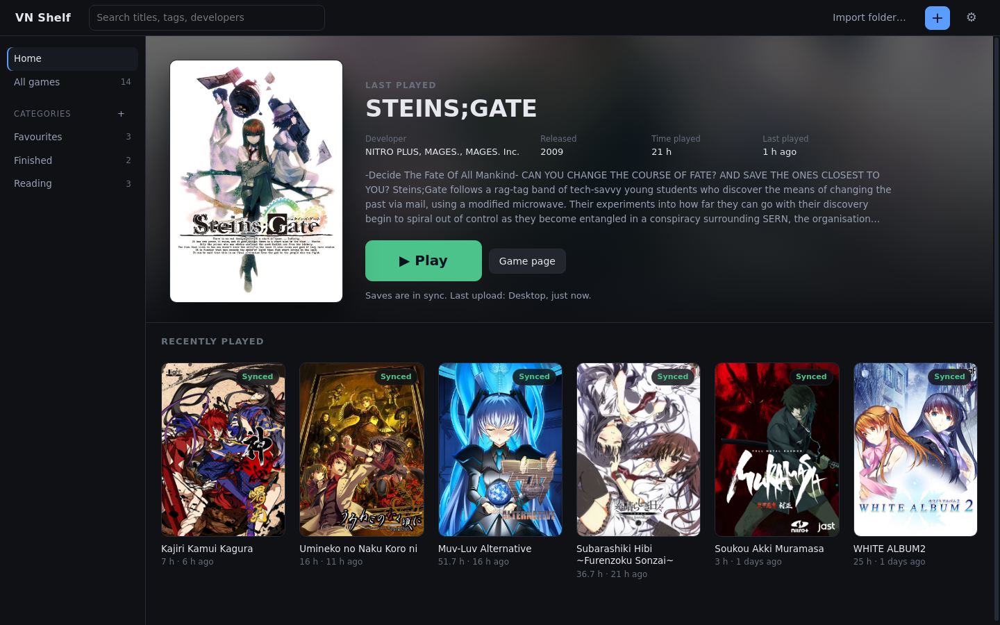
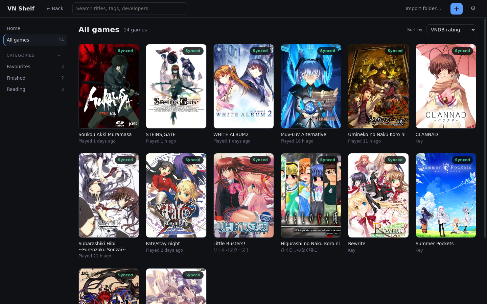
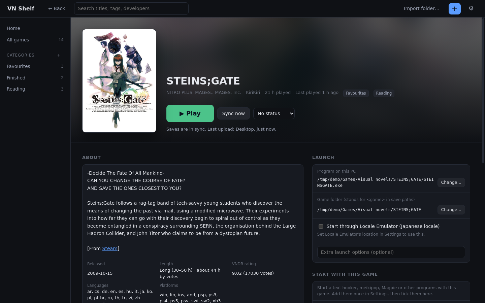
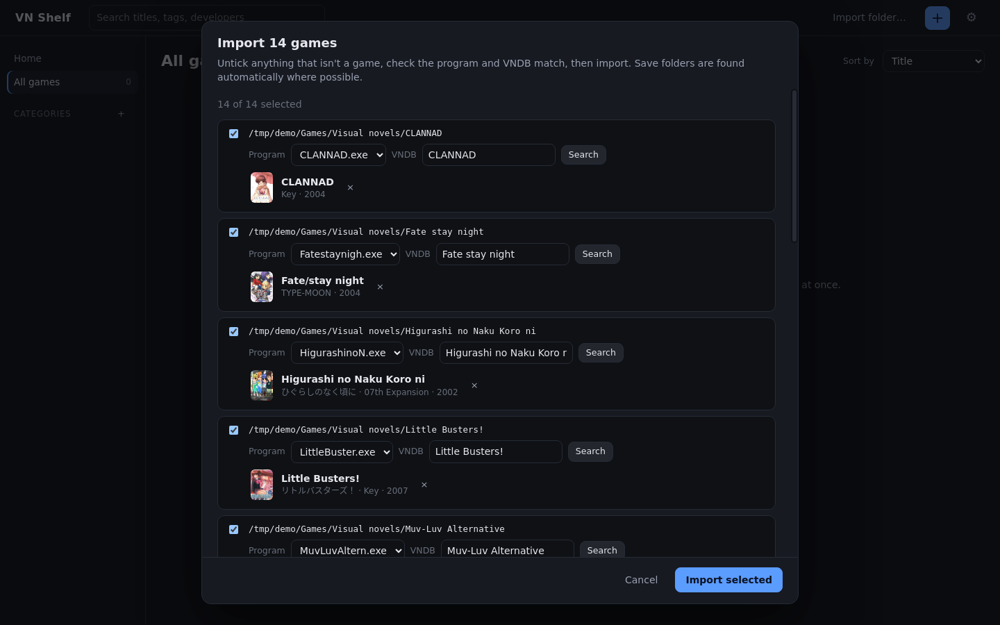
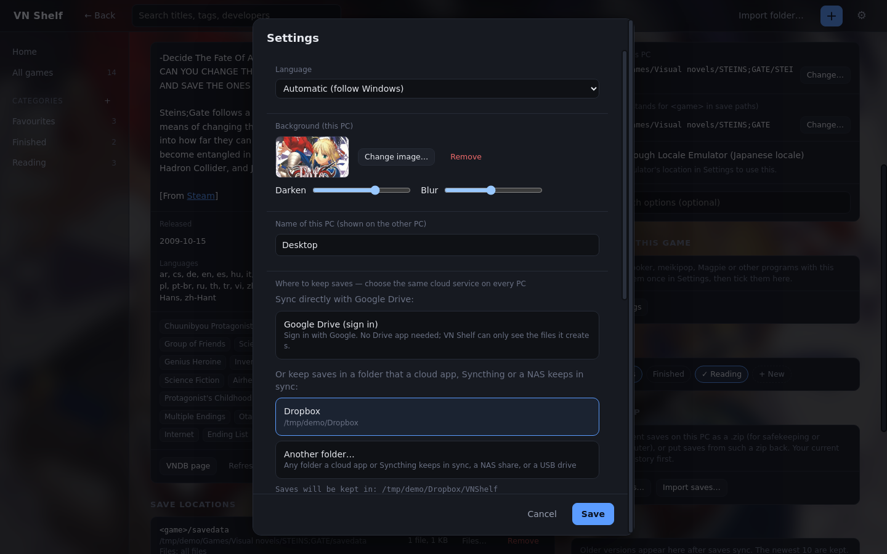
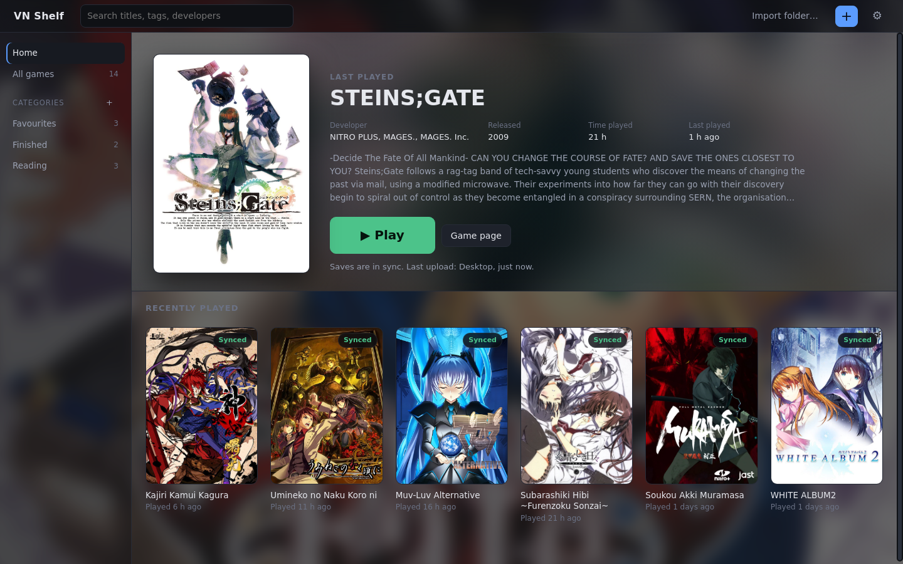
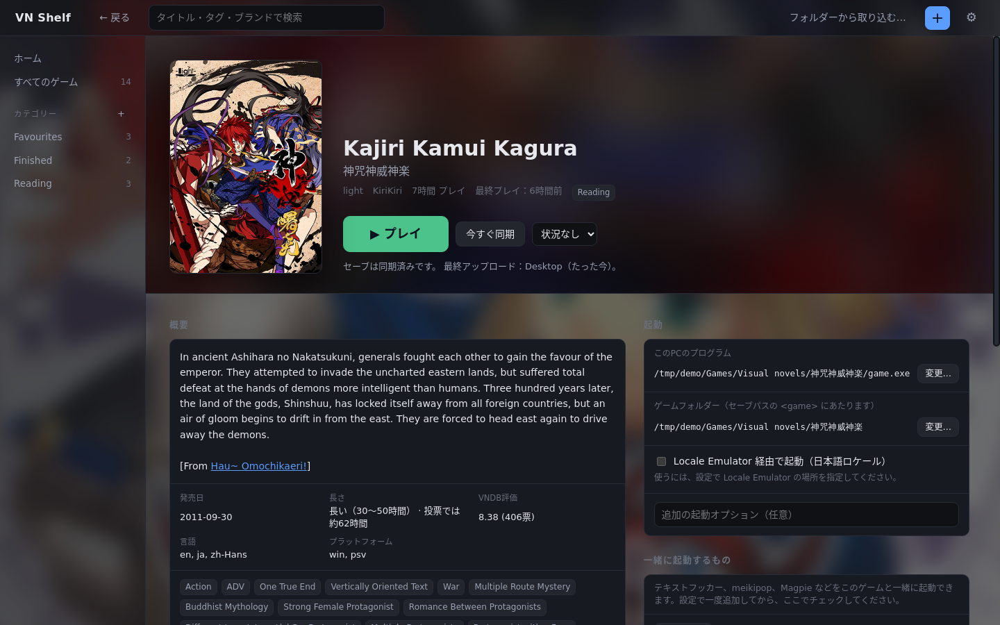

# VN Shelf

A Steam-style library for visual novels that keeps your save files in sync between PCs.

Add your games (one by one or a whole folder at once), and VN Shelf:
- fetches each game's cover, description and tags from VNDB
- keeps your reading status, rating and labels in sync with your VNDB list (optional)
- finds where the game keeps its saves
- brings newer saves down from your other PC before you play, and uploads yours when you close
  the game

The interface is available in English and 日本語.

**[Download the latest release](https://github.com/stagefuel/vn-shelf/releases)** ·
[Wiki / guide](https://github.com/stagefuel/vn-shelf/wiki) · [Changelog](CHANGELOG.md)



| | |
|---|---|
|  |  |
| **Library:** sorting, categories and sync badges | **Game page:** VNDB info, Play, save sync status |
|  |  |
| **Import folder:** finds every game and matches it on VNDB | **Settings:** storage, language, background, companion tools |
|  |  |
| **Backgrounds:** any image, with darkness and blur | **日本語:** the whole interface in Japanese |

## Where saves are kept

You pick one on first run, and the same one on every PC:

| Option | What you need | Notes |
|---|---|---|
| **Google Drive (sign in)** | A Google account | No Drive app needed. VN Shelf can only see the files it creates (`drive.file` permission). |
| **A synced folder** | Google Drive for desktop, OneDrive, Dropbox, iCloud Drive, MEGA, pCloud, Box, Syncthing, a NAS share or a USB drive | Detected automatically on first run. No sign-in; that service's own app moves the files. |

## Features

### Library
- **Home page:** the game you played last, large, with its details and a big Play button, then a
  row of your other recent games.
- **Categories:** your own groups (Reading, Finished, Favourites…), shown in the sidebar like
  folders. They're saved with each game, so every PC sees them.
- **Views:** covers, a list with small covers, or a compact list with reading status, your rating,
  start and finish dates and time played as columns (click a header to sort).
- **Sorting:** by title, last played, recently added, release date, VNDB rating, your rating, start
  or finish date, length or time played, or **My order** (drag games where you want them). Each
  category and reading status keeps its own sort.
- **Status ribbon** on each cover with the game's reading status.
- **Archive downloads:** connect to a Filebrowser Quantum server that keeps a VN index, browse it
  with covers, and download one VN at a time (pause/resume). Archives are unpacked with 7-Zip and
  the game is added already linked to VNDB. Only an API token is kept, on that PC.
- **Search:** matches titles, aliases, developers, categories and VNDB tags, and suggests matching
  games, tags, developers and categories as you type. Click a tag on any game to list every game
  with it.
- **VNDB info on each game:**
  - the description (spoilers hidden until clicked)
  - release date, length (VNDB's category plus the average from votes), rating, languages and
    platforms
  - tags, with spoiler tags hidden unless you choose to show them
- **More from VNDB on each game page:**
  - **screenshots**, in a full-size viewer: the Japanese release's, else the English release's
  - **related VNs** (sequels, fandiscs, same series…), marked when they're in your library or on your
    VNDB list, with **+ Add**
  - **characters**, with details and traits; spoiler characters stay hidden until you ask
  - **staff and brand**: click a name to see everything that writer, artist or brand made
- **Covers:** pick any cover VNDB has for the game, or upload your own and crop it to fit.
- **Notes:** a notes box on each game that saves as you type and syncs to your other PCs.
- **Reading status:** Plan to read, Reading, On hold, Finished, Dropped, with a sidebar filter. Like
  VNDB's list labels, a game can have several (Reading and Finished when re-reading, for example).
  Reading is added automatically when you first play.
- **Your rating and dates:** a 1–10 rating and Started / Finished dates on each game. The dates
  fill themselves in when you start and finish.
- **Not on VNDB?** In **Find…**, **Search IGDB instead** sets the game's title, cover, release date and
  description from IGDB.
- **Titles from the game's window** for games not linked to VNDB, tidied of version numbers and
  engine names.

### My List (your VNDB list)
- **Connect your VNDB account** in Settings → VNDB with a token from vndb.org (My Profile →
  Applications). The token stays on that PC, encrypted.
- **Two-way sync** for every game linked to VNDB:
  - reading statuses ↔ Playing / Finished / Stalled / Dropped / Wishlist, each label on its own
    (ticking one never removes another)
  - categories ↔ your own VNDB labels with the same name
  - your rating and Started / Finished dates

  Notes never sync. When both sides changed the same thing, the newer change wins.
- **Syncs by itself:** at start-up, every 15 minutes and a few seconds after a change, usually with
  one request.
- **My List** page: VNs on your list that aren't in your library, with **+ Add**, and
  **Link** for a game you already have under the same name. It opens instantly from the copy kept
  on your PC.
- **Not in Library:** reading statuses and categories that match a VNDB label also list the VNs on
  your list that aren't in your library, below your own games (optional).

### Adding games
- **Drag a game's `.exe`** (or a shortcut to it) onto the window, or use **+ Add game**, and pick the
  match from VNDB. A game your other PC already added is set up on this PC instead of added twice.
- **Import folder…** adds a whole collection at once:
  1. It finds each game's folder and main program, skipping installers, config tools, cracks and
     updaters.
  2. It matches each game on VNDB.
  3. You review the list before anything is added.
  4. Save folders are set automatically wherever one with files in it is found.

### Finding save folders
- **Auto-detect** recognises common engines: KiriKiri, Ren'Py, RPG Maker (2000–MZ), Siglus,
  BGI/Ethornell, CatSystem2, AliceSoft System 4, Artemis, YU-RIS, NScripter, Unity and age's
  rUGP. When the files don't show the engine, the engine VNDB lists for the game's official release
  is used as a hint (never over what the files show). It also finds folders named after the game in AppData, Documents and Saved Games,
  including inside the developer's folder.
- **Or just play:** for a game with no save folder yet, press Play. When you close the game, VN Shelf
  shows where it saved (from what changed while it ran) and asks you to confirm.
- **Registry saves:** games that keep saves in `HKEY_CURRENT_USER\Software\<maker>\<game>` sync too
  (Windows only), with the same history and conflict handling as files.
- **Choose folder…** or **Type a path…** if you already know it (`%APPDATA%\...` works), and
  **Files…** limits a folder to certain files (for example `Save*.rvdata2`).
- Locations are stored as portable paths like `<appdata>/Nitroplus/Muramasa` or `<game>/savedata`,
  so they work on every PC whatever its username or install drive.

### Playing
- **Press Play.** Newer saves come down first, and yours go up when the game closes. VN Shelf follows
  launchers and Locale Emulator to the real game.
- **Start with this game:** add companion programs once in Settings (a text hooker like
  LunaHook/Textractor, meikipop, Magpie…), then tick which ones start with each game. Each can:
  - start after a delay
  - close when the game closes
  - start with every game

  Options can include `{gameExe}`, `{gameDir}` and `{title}`, which are filled in for each game.
- **Locale Emulator:** set `LEProc.exe` in Settings, then tick it per game.
- **LunaTranslator:** set `LunaTranslator.exe` in Settings, then tick **Start through LunaTranslator**
  per game. Games in Luna's game list start hooked from the beginning.
- **Stop** asks the game to close like its X button, with **Force close** if it doesn't.
- **Upload while playing:** optional; pushes saves about 10 s after each save.
- **Progress bars:** bigger syncs show how many files and MB are done, on the cover and the game page.
- **Play time** counts only the time the game itself ran (not launchers, not sleep), and every PC
  shows the total across your PCs.
- **Games that need administrator rights** start through Windows' permission prompt.

### Keeping up with your other PC
- Changes from your other PC (new games, newer saves, edits) appear by themselves within about 20
  seconds.
- Saves you made while VN Shelf was closed, or in a game started some other way, upload
  automatically. This only ever uploads; it never downloads or asks in the background.
- In Google Drive mode, the whole library is checked with a few requests (one listing, plus downloads
  of only what changed), so start-up and badges are quick even for big libraries.

### Running in the background
- **Start with Windows** (optional, per PC): VN Shelf starts quietly in the tray and keeps your saves
  in sync.
- **Closing the window keeps it in the tray** by default, so saves still sync. Right-click the tray
  icon to quit, or set the X to quit in **Settings → General**.

### Safety
- Nothing is overwritten without being copied to **History** first. The newest 10 versions are kept
  by default, and each can be restored.
- If both PCs saved since they last synced, you choose which to keep. The other copy goes to History.
- A half-downloaded shared folder is detected and waited for, never copied over a good save.
- A warning appears if the game looks open on the other PC. If storage is unreachable, you can play
  offline and saves upload later.
- Saves never come down while that game is open, an empty or missing save folder never wipes the
  cloud copy, only one sync per game runs at a time, and quitting waits for syncs to finish.
- Sync apps' duplicate copies ("(1)", "conflicted copy") are ignored. Two PCs uploading at the same
  moment never mix files, and the replaced upload becomes a choice instead of being overwritten.
- Adding a save folder another game already syncs asks first. If a game is open elsewhere, VN Shelf
  can wait for it to close and then sync.
- **Save-folder limits:**
  - whole drives, system folders and game installs are refused
  - programs, videos, archives, caches, logs and files over 64 MB are never synced
  - a location over 50 MB or 1000 files asks first; one over 500 MB or 5000 files is refused
- **Export saves… / Import saves…** saves a game's saves as a `.zip` or puts them back, with a backup
  to History first.

### Look and navigation
- **One slim top bar on Windows:** the window's own title bar is merged into VN Shelf's bar. Drag it to
  move the window, double-click to maximise.
- **Colours and fonts:** six themes (one light) and every colour adjustable, with a readability
  check; a font for the English interface and one for Japanese, including fonts you add.
- **Background image:** pick any picture in Settings (stored per PC), with sliders for darkness and blur.
- **Copy settings from your other PC:** theme, fonts, background and preferences in one click.
- **Back and forward:** the mouse's side buttons and Alt+← / Alt+→ move through Home, the library,
  filters and game pages. The Back button appears on game pages and tag lists. Clicking "VN Shelf"
  goes Home.
- **Settings in tabs:** General, Saves & sync, Games & tools, Look, and Updates & about.
- **Quick start-up:** the library from last time appears at once and refreshes in the background. In
  Google Drive mode, game details are cached, so only changes are downloaded.

### Updates
- VN Shelf checks for a new version when it starts (you can turn this off) and shows a pop-up you
  can hide. You can also use **Settings → Updates → Check now**.
- The portable `.exe` updates itself. The download is checked against GitHub's SHA-256, saved
  under the new version's file name, and VN Shelf restarts with your settings and library kept.
- **Settings → Updates & about** shows the patch notes for your version and links to this page.
- **Install updates → Install automatically:** downloads updates quietly and restarts into them
  when no game is running and you're not using the window.

## Download

Get `VN-Shelf-<version>-portable.exe` from the [Releases page](https://github.com/stagefuel/vn-shelf/releases)
and run it. Nothing needs installing.

The exe isn't code-signed, so Windows SmartScreen may say "Windows protected your PC". Click
**More info**, then **Run anyway**.

## Privacy

VN Shelf talks to these services, and only for the reasons below:
- **VNDB:** to search for games and fetch their info, covers, screenshots, characters and staff.
  If you connect your VNDB account, also to read and update your list (status, labels, rating,
  dates; never notes).
- **IGDB:** only when you choose **Search IGDB instead** while finding a game (for games VNDB doesn't
  have), through VN Shelf's proxy.
- **GitHub:** to check for and download updates. You can turn this off.
- **Google:** only if you choose Google Drive mode.
- **An archive server:** only the one you connect in Settings → Archive, to read its VN index and
  download what you pick.

Your saves go only to the storage you picked. See [PRIVACY.md](PRIVACY.md).

## Development

```
npm install
npm start                                   # run the app
npm test                                    # unit tests (sync, Drive, detection, import, zip, updates, tools…)
npm run dist:win                            # Windows portable .exe + zip into dist/ (works from Linux; Wine embeds the icon)
node scripts/ui-smoke.js shots/             # end-to-end: two PCs, folder mode (needs a display, e.g. Xvfb)
node scripts/ui-smoke-drive.js shots/       # end-to-end: two PCs, Google Drive mode against a fake Drive
node scripts/ui-smoke-features.js shots/    # end-to-end: import, tags, categories, notes, tools, export, updates, Japanese
node scripts/ui-smoke-vndb.js shots/        # end-to-end: VNDB list sync against a stand-in VNDB (no internet needed)
node scripts/ui-smoke-archive.js shots/     # end-to-end: archive downloads against a stand-in server (needs 7z)
```

Set `VNS_EXE` to a packaged `VN Shelf.exe` to run the end-to-end checks against a real build.

**Layout:**
- `src/core`: plain Node with no Electron. This holds everything that touches saves, as well as
  detection, import, VNDB, zip and updates.
- `src/main`: the Electron main process and its API.
- `src/renderer`: the UI (no framework), with English and Japanese strings in `i18n.js` and
  `i18n-ja.js`.

**Releases** are built by GitHub Actions (`.github/workflows/release.yml`):
- Every push runs the tests on Windows and Linux.
- Pushing a `v*` tag builds the Windows exe and publishes a release, with notes taken from that
  version's section of [CHANGELOG.md](CHANGELOG.md).

## License

MIT
